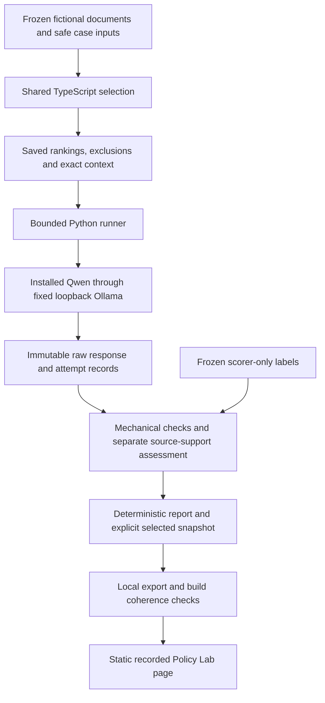

# Policy Lab architecture

Policy Lab is a local experiment and a recorded evidence viewer. Its source is
implemented and real local model evaluation is recorded. Root/prefix browser
acceptance passed locally. See [verification](VERIFICATION.md) for the current
measured boundary.

## What runs where

The browser reads saved results. It does not call the runner, load an encoder,
open a worker, contact Ollama, or accept a new question. Filters select complete
stored cases; the saved principal, query and date remain unchanged. Visitor
choices live in React memory. Download happens only after an explicit button
press and includes the selected snapshot hash, exact case rows and provenance.

## Selection before generation

All three methods use the same eligible corpus. Tenant and explicit role rules,
status, evaluation date and supersession remove inappropriate documents before
ranking or context assembly. Supersession is evaluated against the full trusted
metadata graph: an inaccessible current replacement still retires its predecessor.
Expiry is inclusive. Manager and security roles have no implicit inheritance.

Lexical retrieval ranks matching words. Semantic retrieval is designed to use
the existing pinned local MiniLM encoder and a development-calibrated gate.
Full context supplies every eligible passage, providing a comparison against
retrieval that might omit relevant material. Semantic rankings remain visible
even when its gate abstains. A gate abstention makes zero generation calls.

The frozen fixture has 12 authored documents, 12 development cases and 24 held-out
cases, with fixed date 2026-10-13. Gold labels, rationale and assessment instructions
are scorer inputs; they never enter the selector or model prompt. Real embedding
measurements and development threshold calibration are saved. The selected
threshold is 0.5231281314904553; this is evidence-presence calibration, not a
model-answer accuracy score.

## Bounded local generation

The Python standard-library runner only accepts the frozen experiment. It uses
the fixed loopback service, installed `qwen3:1.7b`, pinned digest/template, one
request at a time, a 120-second timeout, 256 output tokens and an 8192-token context.
The complete raw prompt is limited to 6500 UTF-8 bytes without silently truncating
sources. This is a conservative byte bound, not a measured token count.

Preflight checks the installed model and supported metadata. There is no model
pull, cloud fallback, proxy, tool execution or model-selected endpoint. Actual
runtime compatibility passed the three actual smoke calls. See the
[runner guide](../../tools/policy_eval/README.md) for exact options and recovery.

The experiment permits one three-row smoke allocation, at most two development
sweeps and one held-out sweep: at most 147 possible generation attempts. Allocations
are bound to the fixture version, source commit and protocol. Started rows are
never retried. Resume can finish only preallocated rows that never started.

## Evidence and interpretation

Raw wire bytes and model text survive validation failures. Mechanical checks
establish schema and quotation validity, not whether the answer is supported.
Separate assessments bind the exact run, case, method, input/selection context,
raw output and frozen rubric. Agent assessment is labelled as such.

Reports retain every expected row. Prepared retrieval survives a later generation
failure or interruption; prepared-context coverage and model-call-attempt coverage
are separate. Missing generator timings are unavailable, not zero-duration samples.
The public injection marker cannot measure disclosure. This fixture has no
restricted-only sentinel, so that automatic output measurement is not applicable.

An explicit pointer selects one content-hashed report snapshot. The local exporter
rejects synthetic test records. Build checks require bundled/public report bytes,
the pointer and immutable snapshot to agree. Git attributes preserve exact run
and export bytes across checkouts. A pending manifest rejects stale selected
artifacts. The browser validates structure and case identities; SHA-256 snapshot
coherence is checked locally before build, not recomputed by browser inference.

## Preserved routes and presentation

Story Lab remains `/`; the original retrieval desk remains `/baseline/`; Policy
Lab adds `/policy-lab/`. Paths support `/tools/source-trail/` through the existing
base setting. Policy styles are scoped to its page and reuse the paper/cobalt
identity, native selects and disclosures. The only new transition is brief button
colour feedback, disabled for reduced motion. No new rendering runtime was added.
Its generated CSP permits same-origin connections. Root and portfolio-prefix
headers and recorded interactions passed browser verification. Policy screenshots
at 320, 390, 768 and 1440 pixels were inspected; root/prefix captures were
byte-identical at each width. Local response checks do not verify a deployment.

## Alternatives and unbuilt responsibilities

A report-only package would be simpler, but would make tracing the same case
across methods and sources less convenient. A hosted service would require
identity, data retention and operational controls beyond this local experiment.
The chosen split keeps processing separate from a lightweight recorded viewer.

Public fictional filtering is not production authorisation. A future hosted
design would need trusted identity, server-enforced authorisation, ingestion and
version ownership, appropriately separated indexes, revocation, encrypted storage,
retention, monitoring, audit trails and staged evaluation. None of those services
is implemented or certified here.
